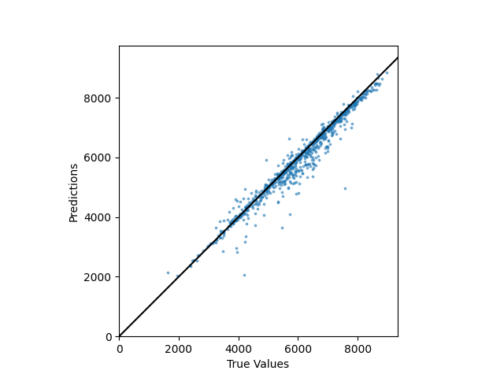

> [!NOTE]
> **AI 사용 내역**: 프로젝트 코드·데이터·보고서는 직접 작성. AI(Claude)는 `README.md` 작성에만 사용

# 2024math

최적화 함수 원리 탐구와 블루베리 생산량 예측

> [!NOTE]
> 경사하강법 계열 최적화 함수(Adam 등)를 탐구하고, 인공신경망으로 야생 블루베리 수확량을 예측한 수학 탐구 프로젝트

## 연구 동기

- 인공지능 학습의 최적화 함수에 미분(경사하강법) 사용
- 최적화 함수 원리 → 인공지능 작동 방식 이해
- 기후위기·식량난 해소가 기대되는 **스마트 팜** 구축 시도

## 이론적 배경

### 손실함수

- 실제값과 예측값의 차이
- MSE (평균 제곱 오차) ↔ 분산
- MAE (평균 절대 오차) ↔ 표준편차

### 최적화 함수

| 함수 | 핵심 |
| --- | --- |
| 경사하강법 (GD) | 기울기 반대 방향으로 이동, 이동 폭 = 학습률 |
| Momentum | 이전 기울기를 누적해 이동 속도 조절 |
| AdaGrad | 파라미터별 학습률 개별 조정 (기울기 제곱합 기반) |
| Adam | Momentum + RMSprop 결합, 현재 가장 널리 사용 |

> [!WARNING]
> 경사하강법의 한계
> - 지역 최솟값 문제 (Local Minimum)
> - 고원 현상 (Plateau Effect): 기울기가 0에 수렴 → 학습 정지

## 데이터

- 출처: Kaggle — Saurabh Shahane, [Wild Blueberry Yield Prediction](https://www.kaggle.com/datasets/saurabhshahane/wild-blueberry-yield-prediction)
- 774행, 17열
- 입력 13개 변수
  - 블루베리 평균 크기 (`clonesize`)
  - 벌 밀도 4종: 꿀벌 · 호박벌 · 안드레나 · 뿔가위벌
  - 개화기 기온 6종: 상층부·하층부 각각 최고·최저·평균
  - 강수: 비 온 날 수, 평균 비 온 날
- 출력: 수확량 (`yield`)

## 모델

- Keras Sequential/Functional, Dense + ReLU
- 입력 13 → 은닉층 4개 → 출력 1
- 최적화: Adam / 손실: MAE / 검증 비율: 0.3

| 모델 폴더 | 학습률 | 은닉층 노드 | 에포크 |
| --- | --- | --- | --- |
| `le-4_1000-1000-1000-1000_12000` | 1e-4 | 1000 × 4 | 12,000 |
| `1e-6_100-50-25-12_1200000` | 1e-6 | 100-50-25-12 | 1,200,000 |
| `1e-7_100-50-25-12_12000000` | 1e-7 | 100-50-25-12 | 12,000,000 |

## 결과

- 보고서 채택 모델: 1e-4 / 1000 × 4 / 12,000 에포크
- 평균 오차 182.33064, 약 5% 내외 오차율
- 산점도: X축 실제 생산량, Y축 예측 생산량, 검은 선 = Y = X



> [!TIP]
> 비교용 산점도: [`1e-6`](Model/1e-6_100-50-25-12_1200000/result.png), [`1e-7`](Model/1e-7_100-50-25-12_12000000/result.png)

## 구조

```
2024math/
├── Code/
│   ├── blueberry.py   # 모델 정의·학습·저장
│   └── load.py        # 모델 로드, 오차 계산, 산점도 출력
├── Data/
│   ├── WildBlueberryPollinationSimulationData.csv
│   └── Data in brief_WildBlueberryPollinationSimulation.docx   # 데이터 설명서
├── Model/             # 학습된 모델(.keras) + 결과 산점도(result.png)
└── Document/
    └── 보고서.pdf
```

## 실행 환경

- Python 3
- 의존성

```bash
pip install tensorflow keras pandas matplotlib
```

> [!WARNING]
> `Code/path.py` 필요 (경로 은닉 모듈). 직접 생성하거나 코드에서 `bpath` 제거

```python
# Code/path.py
bpath = "<프로젝트 루트 경로>/"
```

## 문서

- [보고서](Document/보고서.pdf)
- [데이터 설명서](Data/Data%20in%20brief_WildBlueberryPollinationSimulation.docx)

## 제작

- 윤영서 ([@yys0527](https://github.com/yys0527))
